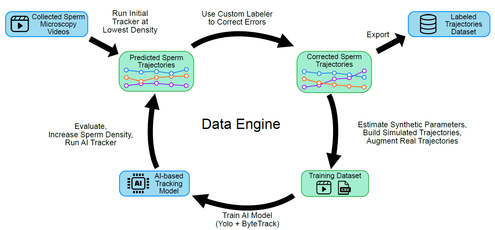
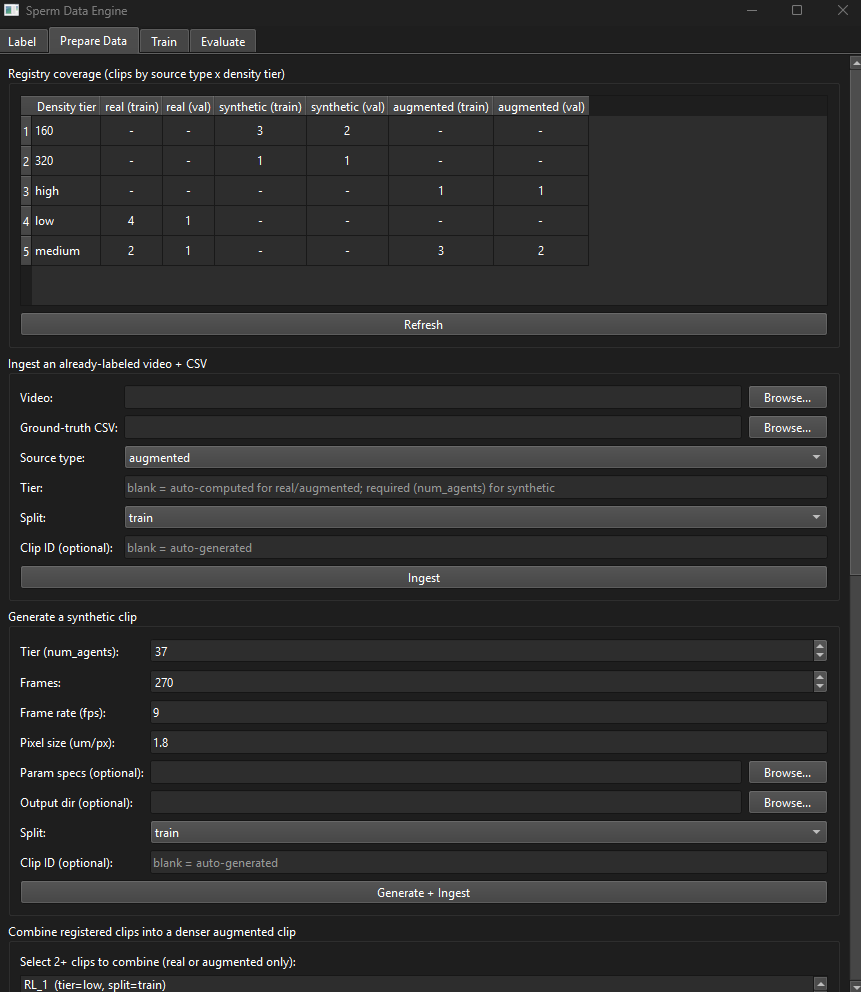
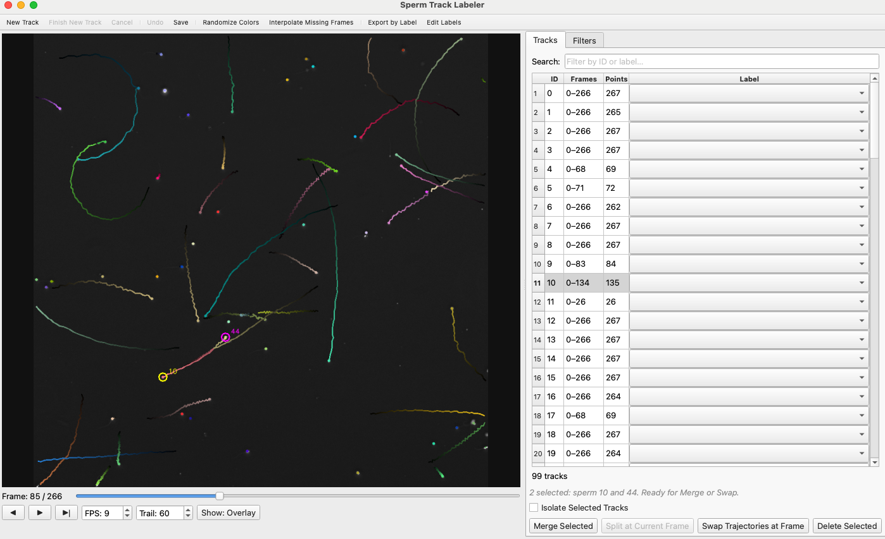

# Sperm Data Engine

A "data engine" loop — **label → generate synthetic/augmented data → train →
evaluate → bootstrap-label denser video → repeat** — for building a YOLO +
ByteTrack sperm-tracking pipeline from a small amount of hand-labeled,
low-density video up to a model that handles much higher sperm densities,
without needing every density level hand-labeled from scratch.

This folder lives inside
[CAS-ReproLab/Sperm_Object_Tracking](https://github.com/CAS-ReproLab/Sperm_Object_Tracking),
alongside `UnifiedFramework/` (the baseline tracker this project builds on),
and is licensed under that repository's GPL-3.0 license (see its root
`LICENSE`) unless noted otherwise below. It accompanies the paper:

> **A data engine for AI-assisted labeling of high-density sperm microscopy
> videos**
> Coming soon — full author list and bioRxiv DOI to follow shortly.



## Contents

- [What's in this repo](#whats-in-this-repo)
- [Data and trained models](#data-and-trained-models)
- [Installation](#installation)
- [Repository layout](#repository-layout)
- [Running the pipeline](#running-the-pipeline)
  - [1. Label a video](#1-label-a-video)
  - [2. Generate synthetic / augmented data](#2-generate-synthetic--augmented-data)
  - [3. Train](#3-train)
  - [4. Evaluate](#4-evaluate)
  - [GUI hub (all of the above in one app)](#gui-hub)
- [Analysis tools](#analysis-tools)
- [Known limitations](#known-limitations)
- [Citing this work](#citing-this-work)
- [License](#license)

## What's in this repo

This is the `data_engine/` package: a from-scratch rebuild of the pipeline,
organized as one directory per loop stage (`stages/label`, `stages/generate`,
`stages/train`, `stages/validate`), a clip registry that tracks every piece
of data (real, synthetic, augmented) and its train/val split, a set of
analysis scripts used for the paper's figures and metrics, and a PyQt6 GUI
("the hub") that wraps every stage above in one app for non-coder
collaborators.

It does **not** include large data or trained weights — those are hosted
separately (see below) since this is a git repository, not a data store.

## Data and trained models

The hand-labeled ground-truth videos/trajectories and the trained **Loop 1
(low→medium density) model checkpoint** referenced in the paper are hosted
on Google Drive, not in this repository:

**[Google Drive folder](https://drive.google.com/drive/u/0/folders/1PobyhqbruXCbv64oYyg4q49FDriNLL3u)**
- `labeled_data/` — every currently-labeled real clip (video + final
  ground-truth CSV)
- `loop1_low-to-medium_model/` — the Loop 1 checkpoint (`best.pt`) plus its
  `run_manifest.json`/`args.yaml`/`dataset_used.yaml`/`results.csv` for
  exact training-run provenance

After downloading, place each clip's folder under `data/<clip_id>/` (or any
location you prefer, then update that clip's `path`/`source_video`/
`ground_truth_csv` entries in `data_engine/registry/manifest.yaml` to match)
so the paths in `manifest.yaml` resolve. `data_engine/registry/manifest.yaml`
in this repo describes the full set of clips used across this project
(including work beyond the first loop iteration); the Drive folder's actual
contents may be a subset of what's listed there — check the Drive folder's
own index for exactly which clips are included.

To use the trained Loop 1 checkpoint, download `best.pt` and pass its path
directly wherever a command below takes `--model`.

## Installation

Requires Python 3.12 and (for realistic training speed) an NVIDIA GPU with
CUDA. Developed and run on Windows; nothing in the code is Windows-specific
except two things noted inline in `train.py` and `jobs.py` docstrings
(process-launching flags for the GUI's detached training jobs).

```bash
conda env create -f environment.yml
conda activate sperm-engine
pip install -r requirements.txt
```

See `requirements.txt` for a note on why this installs via pip rather than
`conda install` for the scientific-Python stack.

## Repository layout

```
data_engine/
  registry/          clip registry (manifest.yaml) + schema + YOLO-dataset-yaml export
  stages/
    label/            get a video labeled: from scratch, or tracker-assisted
                       (bootstrap_label.py), via a PyQt6 correction GUI
    generate/         synthetic video generation (Langevin motility model),
                       real-video augmentation (combine clips to raise density),
                       and the parameter-fitting pipeline (fit the model's
                       motion parameters from real labeled trajectories)
    train/            YOLO training/fine-tuning CLI
    validate/         run a trained model + tracker over a video, score
                       against ground truth (CTC-style DET/TRA/LNK/TF/
                       MOTA/IDF1/HOTA metrics)
  metrics/            aggregate per-clip metrics by density tier
  analysis/           crossover-impact analysis, flow/trail visualizations,
                       the paper's figure-generation scripts
  gui/                the PyQt6 hub: one tab per loop stage
  common/             shared trajectory I/O format + vendored CTC metrics
run_loop.py           chains train -> evaluate in one command
```

## Running the GUI

Every stage of the pipeline is from the built into the GUI and is the simplest way to get started with the program.

```bash
python -m data_engine.gui.hub
```



The tabs are in order from left to right for the stages of the pipeline (Label / Prepare Data / Train / Evaluate).

## Running the pipeline with CLI commands

If desired, each stage can be ran separately from the terminal/command line. Run every command below as a module, from inside this `Sperm_Data_Engine/`
folder (not from inside `data_engine/` itself) — e.g.
`python -m data_engine.stages.train.train ...`.

### 1. Label a video

From scratch:
```bash
python -m data_engine.stages.label.label --video path/to/video.mp4
```

Tracker-assisted (runs Trackpy, or a trained YOLO model if `--model` is
given, then opens the correction GUI pre-loaded with those predictions —
much faster than labeling from nothing):
```bash
python -m data_engine.stages.label.bootstrap_label --video path/to/video.mp4
python -m data_engine.stages.label.bootstrap_label --video path/to/video.mp4 --model best.pt --tracker bytetrack
```

The labeler program is where a human
reviews/corrects trajectories. It provides playback with motion trails, click-to-select,
merge/split/swap, a crossover finder, and birth-event filters.



Both register the corrected result into the clip registry automatically.

### 2. Generate synthetic / augmented data

Synthetic video at a target density (sperm count):
```bash
python -m data_engine.stages.generate.synthesize --tier 160 --frames 270
```

Fit the simulator's motion parameters from your own labeled real data,
instead of using the simulator's hand-tuned example defaults:
```bash
python -m data_engine.stages.generate.fit_params --out-dir data_engine/data/fitted_params/my_fit
python -m data_engine.stages.generate.synthesize --tier 160 --param-specs data_engine/data/fitted_params/my_fit/param_specs.json
```

Combine multiple registered real clips into one higher-density clip
(optionally adding rotated/mirrored variants for further density/variety):
```bash
python -m data_engine.stages.generate.augment --clips RL_1 RL_2 --rotate --mirror
```

Register an already-labeled video+CSV pair (real, synthetic, or augmented)
into the clip registry:
```bash
python -m data_engine.stages.generate.ingest --video v.mp4 --csv tracks.csv --source real --split train
```

### 3. Train

```bash
python -m data_engine.stages.train.train --epochs 50 --tiers low medium
python -m data_engine.stages.train.train --resume-from previous/weights/best.pt --epochs 20 --lr0 0.001
```

`--tiers` filters the registry to specific density tiers; omit it to train
on every registered clip. See `train.py --help` for the full flag set
(all of Ultralytics' `model.train()` passthrough options are exposed).

### 4. Evaluate

```bash
python -m data_engine.stages.validate.evaluate --model best.pt --tracker bytetrack
python -m data_engine.stages.validate.evaluate --tracker trackpy   # score the Trackpy baseline instead
```

Produces per-clip metric CSVs and a density-tier summary (mean metrics per
density bin, plus an aggregate "all clips" row), with both unfiltered and
stationary-sperm-filtered variants side by side.

## Analysis tools

- `analysis/crossover_impact.py` — does tracker failure (ID switches,
  dropped detections) concentrate around geometric sperm-crossover events?
  Produces the paper's relative-risk comparison across trackers.
- `analysis/flow_viewer.py` — render a tracked video as an annotated mp4
  (motion trails or ID labels).
- `analysis/trails_figure.py`, `analysis/synthetic_showcase.py` — the
  specific figure-generation scripts used for figures in the paper.

## Known limitations

- `wobble_w`/`wobble_delta` (short-timescale flagellar beat parameters) are
  not fittable from this dataset's 9 fps recordings — aliasing past the
  ~4.5 Hz Nyquist limit makes the true-to-measured mapping non-invertible —
  and are pinned to hand-tuned defaults rather than fit from real data.
- The crossover-event likelihood score (`stages/label/crossover_detector.py`)
  uses heuristically chosen weights (see the paper's Methods), not weights
  fit to labeled crossover/non-crossover outcomes.
- Density-tier bin boundaries (`low`/`medium`/`high`/`very_high`) were
  chosen to match this dataset's dilution series and are a config constant
  (`registry/registry.py: DENSITY_BINS`), not a universal standard.

## Citing this work

Coming soon.

## License

GPL-3.0, inherited from the parent repository's root
[`LICENSE`](https://github.com/CAS-ReproLab/Sperm_Object_Tracking/blob/main/LICENSE)
— no separate license file lives in this folder.

This folder vendors a copy of
[Py-CTCMetrics](https://github.com/CellTrackingChallenge/py-ctcmetrics) by
Timo Kaiser (`data_engine/common/ctc_metrics/`) for CTC-style tracking
metrics, under its own
[BSD-2-Clause license](data_engine/common/ctc_metrics/LICENSE) (permissive
and GPL-compatible, so this doesn't conflict with the above). If you use
these specific metrics, consider also citing the paper that introduced them:
Timo Kaiser et al., ["CHOTA: A Higher Order Accuracy Metric for Cell
Tracking"](https://arxiv.org/abs/2408.11571).
